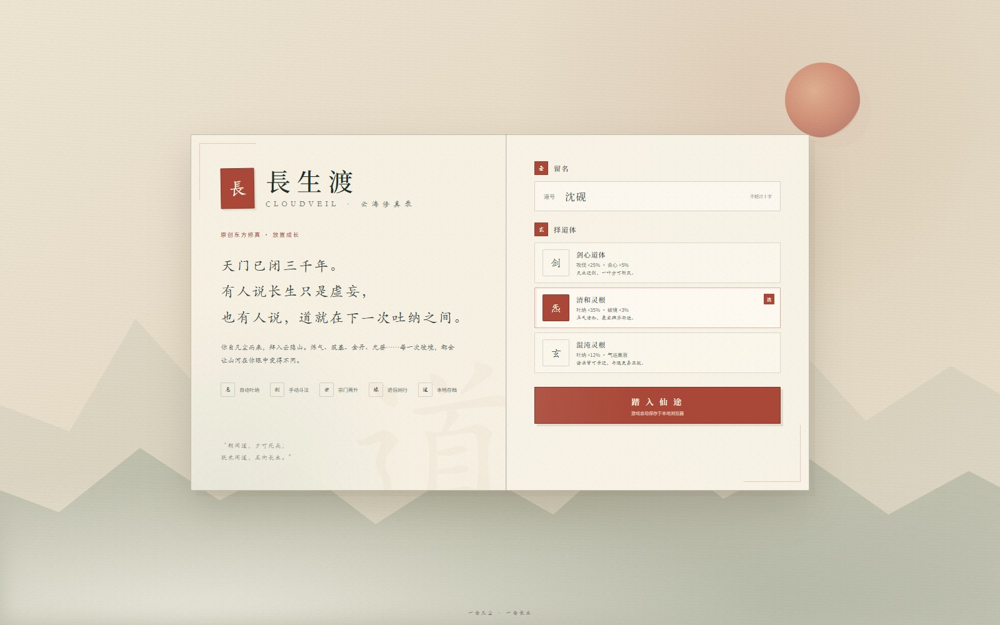
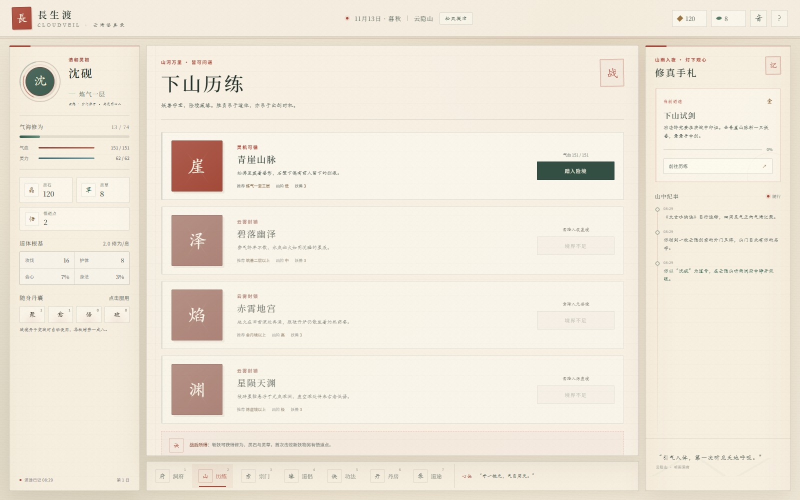
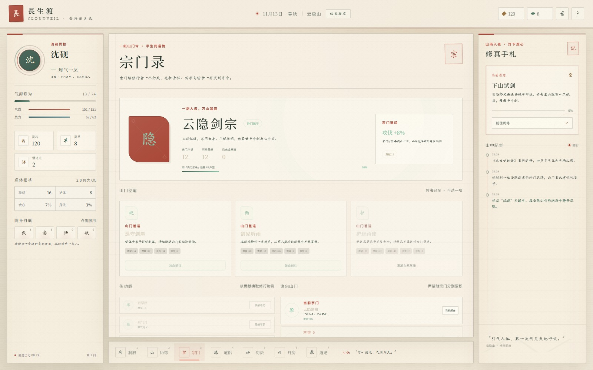
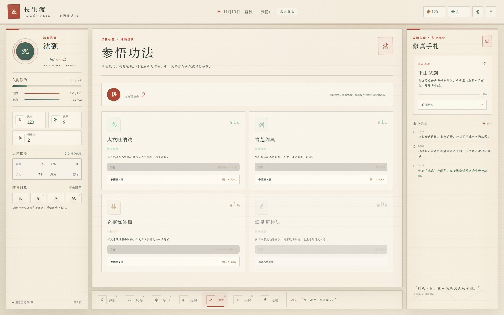
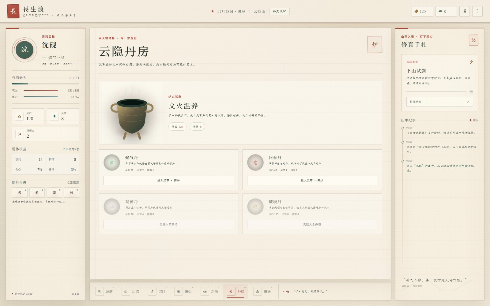
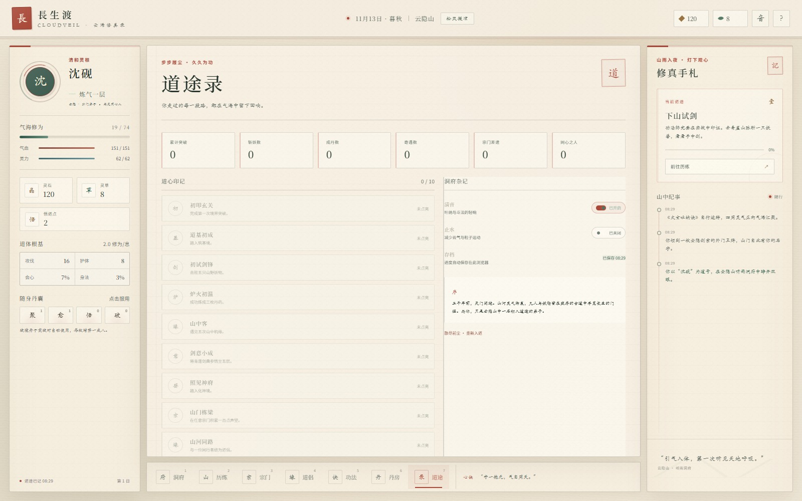

<p align="center">
  
</p>

# Cloudveil: Path of Longevity

<p align="center">
  <strong>长生渡 · 云海修真录</strong><br>
  An original, dependency-free cultivation RPG that runs entirely in your browser.<br>
  一款无需安装、无需联网的原创水墨修真放置游戏。
</p>

<p align="center">
  <a href="LICENSE"></a>
  
  
</p>

<p align="center">
  <a href="https://zhuanght-1201.github.io/cloudveil-longevity/"><strong>▶ Play Online / 在线游玩</strong></a>
  ·
  <a href="#quick-start--快速开始">Quick Start</a>
  ·
  <a href="#features--玩法特色">Features</a>
  ·
  <a href="CONTRIBUTING.md">Contributing</a>
</p>

**Cloudveil: Path of Longevity** is a single-page xianxia-inspired cultivation game. Turn every breath into progress, challenge beasts, climb through nine realms, gain standing in a sect, brew pills, and find someone to share the long road with.

《长生渡》是一款以东方玄幻修真为灵感的单页浏览器游戏。吐纳炼气、下山历练、宗门晋升、炼丹寻缘，在九大境界与八十一个小境界中一路问道长生。界面以宣纸、墨线、青黛与朱砂为骨架，像翻阅一册会随修行展开的山门手札。

The game has no backend, package manager, build step, external image service, or online account requirement. Progress is stored locally in the browser.

游戏不依赖后端、构建工具或外部图片服务，浏览器本地即可保存全部进度。

## Screenshots / 游戏截图

<p align="center">
  
  
</p>

| Sect system / 宗门系统 | Dao companions / 道侣系统 |
| --- | --- |
|  |  |
| **Combat / 战斗** | **Cultivation techniques / 功法** |
|  |  |
| **Alchemy / 炼丹** | **Journey records / 道途** |
|  |  |

<p align="center">
  
  
</p>

## Features / 玩法特色

| English | 简体中文 |
| --- | --- |
| **81 cultivation stages.** Advance through Qi Refining, Foundation Establishment, Golden Core, Nascent Soul, Spirit Transformation, Void Refining, Body Integration, Mahayana, and Tribulation Transcendence. | **八十一个修炼阶段。** 历经炼气、筑基、金丹、元婴、化神、炼虚、合体、大乘、渡劫九大境界。 |
| **Idle and active cultivation.** Qi accumulates automatically; manually circulate your meridians for faster progress. | **放置与主动修行。** 修为自动增长，也可手动运转周天加速吐纳。 |
| **Turn-based combat.** Enter four dangerous regions, manage health and spirit energy, use techniques, and retreat when necessary. | **回合制历练。** 探索四大险境，管理气血与灵力，以剑诀破敌，也可以收剑遁走。 |
| **Four original sects.** Each sect has its own reputation, contribution economy, rank progression, missions, shop, and passive bonus. | **四大原创宗门。** 每个宗门都有独立声望、贡献、位阶、差遣、传功阁与专属被动。 |
| **Three Dao companions.** Build affection through conversation, gifts, and journeys. Bond exclusively with one companion and unlock a unique bonus. | **三位原创道侣候选。** 通过论道、赠礼与同游提升好感，最终与一人结契并获得专属增益。 |
| **Techniques and alchemy.** Upgrade four cultivation paths and craft pills for cultivation, healing, insight, and breakthroughs. | **功法与炼丹。** 参悟四条成长路线，炼制聚气、回春、凝神与破境丹药。 |
| **Random fortunes and offline progress.** Discover events while exploring and continue cultivating while away. | **随机机缘与离线收益。** 寻访山中奇遇，关闭页面后周天仍会继续运转。 |
| **Responsive and persistent.** Desktop and mobile layouts are supported; save data stays in local browser storage. | **响应式与自动存档。** 适配桌面与手机，进度保存在浏览器本地。 |

## Quick Start / 快速开始

### Play locally / 本地游玩

Clone the repository and open the game:

```bash
git clone https://github.com/ZhuangHT-1201/cloudveil-longevity.git
cd cloudveil-longevity
```

You can double-click `index.html`, or serve the directory locally:

```bash
python -m http.server 8080
```

Then visit <http://localhost:8080>.

无需安装依赖。也可以直接双击 `index.html` 开始游戏。

### Controls / 操作

| Key | English | 中文 |
| --- | --- | --- |
| `Space` | Circulate qi | 运转周天 |
| `B` | Attempt a breakthrough | 冲击瓶颈 |
| `F` | Search for a fortune | 寻访机缘 |
| `1`–`7` | Open Home, Adventure, Sect, Companions, Techniques, Alchemy, or Journey | 切换洞府、历练、宗门、道侣、功法、丹房、道途 |

## Cultivation Systems / 系统说明

### Realms and breakthroughs / 境界与突破

Every realm contains nine layers. Fill your qi sea, then challenge the bottleneck. Higher realms are harder to break through; breakthrough pills and a stronger body improve the odds.

每个境界包含九层。气海盈满后可以冲击瓶颈，境界越高成功率越低；破境丹与体魄功法能够提高成功率。

### Sects / 宗门

Choose among **Cloudveil Sword Sect**, **Taixu Dao Palace**, **Hundred Herbs Valley**, and the **Starry Myriad Pavilion**. Reputation is tracked separately for each sect, while rank and contribution unlock missions, supplies, and passive bonuses.

可在云隐剑宗、太虚问道宫、百草长生谷和星罗万象阁之间选择归属。各宗声望独立累积，位阶与贡献会解锁差遣、物资和被动加成。

### Companions / 道侣

Meet **Su Wanzhao**, **Luo Qingheng**, and **Xie Tingyun**. Affection rises through tea conversations, gifts, and shared journeys. At 82 affection, a companion can become your exclusive Dao companion, granting a permanent combat or cultivation bonus.

可结识苏晚照、洛青蘅与谢停云。论道、赠礼和同游都会提高好感；好感达到 82 后可结为唯一道侣，获得永久战斗或修行增益。

### Combat / 战斗

Battles use a turn-based action flow. Basic attacks are reliable, sword techniques consume spirit energy, meditation restores resources, and pills can rescue a dangerous encounter.

战斗采用回合制行动。普通剑击稳定输出，青莲剑诀消耗灵力造成高额伤害，调息可恢复资源，回春丹能扭转危局。

## Technical Overview / 技术概览

- **HTML5** for the application structure
- **CSS3** for the paper-and-cinnabar visual system, layout, and responsive design
- **Vanilla JavaScript** for game simulation, combat, economy, saving, and UI rendering
- **Canvas** for ambient qi particles
- **Web Audio API** for lightweight procedural sound
- **LocalStorage** for save persistence
- **GitHub Actions + GitHub Pages** for static deployment

No frameworks, no build step, no runtime dependencies.

项目没有框架、构建步骤或运行时依赖。

## Project Structure / 项目结构

```text
cloudveil-longevity/
├── index.html                 # Game shell and UI structure
├── favicon.svg               # Cinnabar seal site icon
├── styles.css                # Base components and responsive layout
├── paper-theme.css           # Rice-paper and cinnabar visual layer
├── game.js                   # Game state, progression, combat, and saves
├── docs/
│   └── screenshots/          # README screenshots
├── .github/
│   └── workflows/pages.yml   # GitHub Pages deployment
├── CONTRIBUTING.md
├── LICENSE
└── README.md
```

## Save Data / 存档

Progress is stored under the LocalStorage key `chang_sheng_du_original_v1`. Use the **Journey → Reset** button in the game to start over.

游戏进度保存在浏览器 `localStorage` 的 `chang_sheng_du_original_v1` 键中。可在“道途”页面重置进度。

## Contributing / 参与贡献

Contributions are welcome. Please read [CONTRIBUTING.md](CONTRIBUTING.md) before submitting a pull request.

欢迎参与开发。提交 PR 前请阅读 [CONTRIBUTING.md](CONTRIBUTING.md)。Bug reports, original content, accessibility improvements, balancing suggestions, and translations are all valuable.

## Roadmap / 后续计划

- Additional sects and companion story arcs
- More random events and secret realms
- Spirit beasts and artifact sets
- Save export/import
- English localization inside the game
- Further accessibility and keyboard navigation improvements

## Originality / 原创声明

Cloudveil is an original fictional work. Its setting, characters, names, dialogue, UI, and visual assets are original. It draws on broad xianxia genre motifs such as cultivation realms, sects, alchemy, and companions, but does not reproduce protected text or distinctive settings from any published novel or game.

《长生渡》的世界观、角色、名称、文本、界面与美术均为原创，仅化用修真文学中常见的境界、宗门、炼丹和同行等公共题材元素，不摘录或复制任何已出版小说与游戏中的受保护内容。

## License / 许可证

Released under the [MIT License](LICENSE).

本项目采用 [MIT 许可证](LICENSE) 开源。
