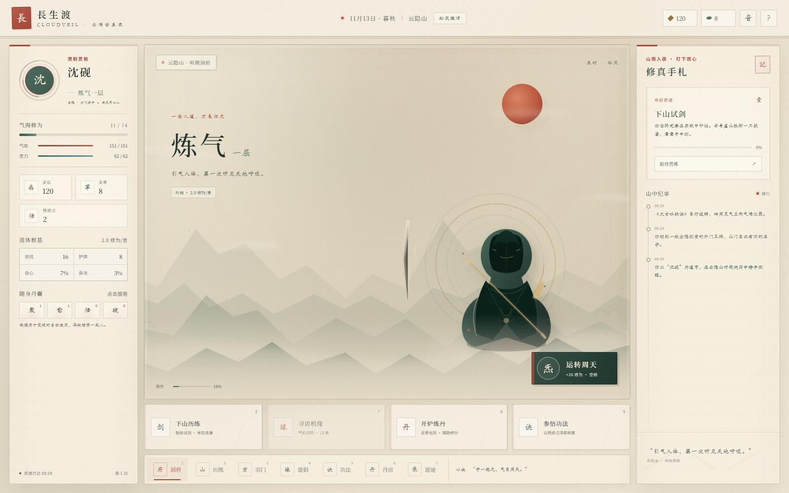
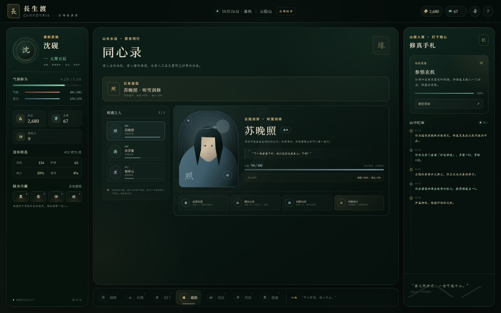
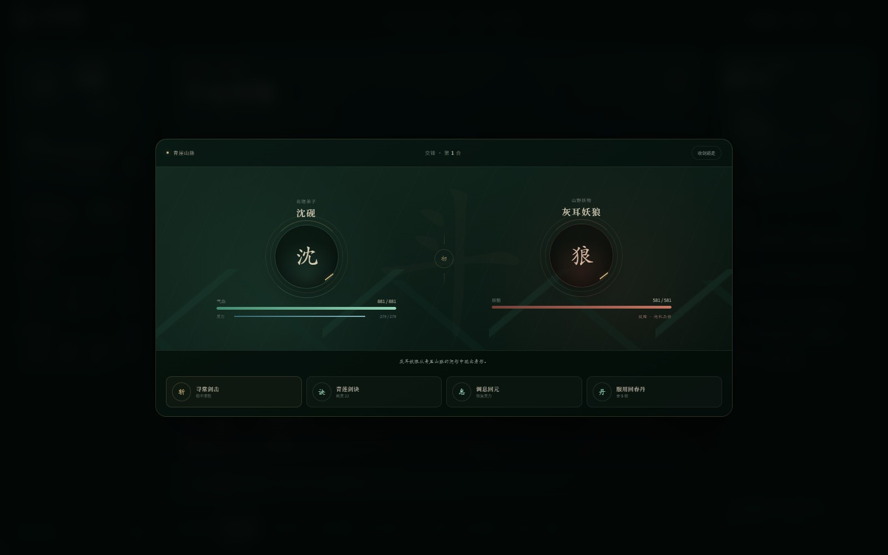
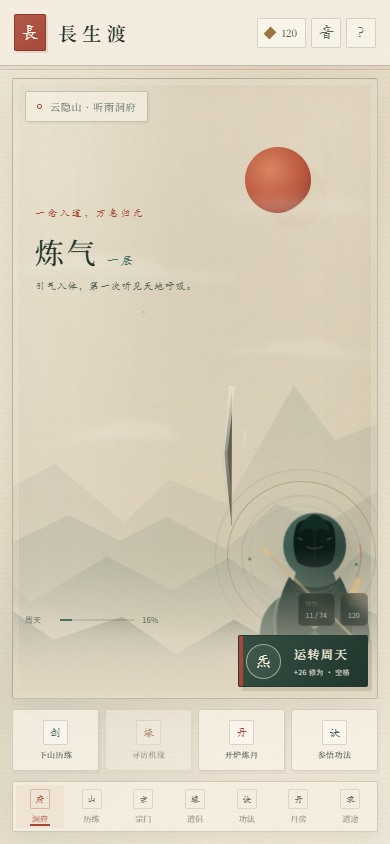
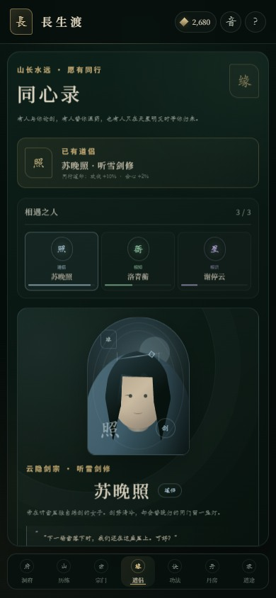

<p align="center">
  
</p>

# Cloudveil: Path of Longevity

<p align="center">
  <strong>Turn every breath into progress.</strong><br>
  An original, dependency-free cultivation RPG that runs entirely in your browser.<br>
  No installation, account, or internet connection is required after the files are available locally.
</p>

<p align="center">
  <a href="LICENSE"></a>
  
  
</p>

<p align="center">
  <a href="https://zhuanght-1201.github.io/cloudveil-longevity/"><strong>Play Online</strong></a>
  &nbsp;|&nbsp;
  <a href="#quick-start">Quick Start</a>
  &nbsp;|&nbsp;
  <a href="#features">Features</a>
  &nbsp;|&nbsp;
  <a href="CONTRIBUTING.md">Contributing</a>
</p>

**Cloudveil: Path of Longevity** is a single-page xianxia-inspired cultivation game. Turn every breath into progress, challenge beasts, climb through nine realms, gain standing in a sect, brew pills, and find someone to share the long road with.

The experience spans 81 cultivation stages, four original sects, turn-based expeditions, alchemy, technique mastery, and three potential Dao companions. Its visual language combines rice paper, ink lines, muted jade, and cinnabar accents, evoking a mountain journal that unfolds as the journey progresses.

The game has no backend, package manager, build step, external image service, or online account requirement. Progress is stored locally in the browser.

## Screenshots

<p align="center">
  
  
</p>

| Sect system | Dao companions |
| --- | --- |
|  |  |
| **Combat** | **Cultivation techniques** |
|  |  |
| **Alchemy** | **Journey records** |
|  |  |

<p align="center">
  
  
</p>

## Features

- **81 cultivation stages.** Advance through Qi Refining, Foundation Establishment, Golden Core, Nascent Soul, Spirit Transformation, Void Refining, Body Integration, Mahayana, and Tribulation Transcendence.
- **Idle and active cultivation.** Qi accumulates automatically, while manually circulating the meridians accelerates progress.
- **Turn-based combat.** Explore four dangerous regions, manage health and spirit energy, use techniques, and retreat when necessary.
- **Four original sects.** Each sect has its own reputation, contribution economy, rank progression, missions, shop, and passive bonus.
- **Three Dao companions.** Build affection through conversation, gifts, and journeys, then bond exclusively with one companion for a unique bonus.
- **Techniques and alchemy.** Upgrade four cultivation paths and craft pills for cultivation, healing, insight, and breakthroughs.
- **Random fortunes and offline progress.** Discover events while exploring and continue cultivating while away.
- **Responsive and persistent.** Desktop and mobile layouts are supported, with saves kept in local browser storage.

## Quick Start

### Play locally

Clone the repository and open the game:

```bash
git clone https://github.com/ZhuangHT-1201/cloudveil-longevity.git
cd cloudveil-longevity
```

You can double-click `index.html`, or serve the directory locally:

```bash
python -m http.server 8080
```

Then visit <http://localhost:8080>.

No dependencies are required. You can also open `index.html` directly.

### Controls

| Key | Action |
| --- | --- |
| `Space` | Circulate qi |
| `B` | Attempt a breakthrough |
| `F` | Search for a fortune |
| `1`–`7` | Open Home, Adventure, Sect, Companions, Techniques, Alchemy, or Journey |

## Cultivation Systems

### Realms and breakthroughs

Every realm contains nine layers. Fill your qi sea, then challenge the bottleneck. Higher realms are harder to break through; breakthrough pills and a stronger body improve the odds.

### Sects

Choose among **Cloudveil Sword Sect**, **Taixu Dao Palace**, **Hundred Herbs Valley**, and the **Starry Myriad Pavilion**. Reputation is tracked separately for each sect, while rank and contribution unlock missions, supplies, and passive bonuses.

### Companions

Meet **Su Wanzhao**, **Luo Qingheng**, and **Xie Tingyun**. Affection rises through tea conversations, gifts, and shared journeys. At 82 affection, a companion can become your exclusive Dao companion, granting a permanent combat or cultivation bonus.

### Combat

Battles use a turn-based action flow. Basic attacks are reliable, sword techniques consume spirit energy, meditation restores resources, and pills can rescue a dangerous encounter.

## Technical Overview

- **HTML5** for the application structure
- **CSS3** for the paper-and-cinnabar visual system, layout, and responsive design
- **Vanilla JavaScript** for game simulation, combat, economy, saving, and UI rendering
- **Canvas** for ambient qi particles
- **Web Audio API** for lightweight procedural sound
- **LocalStorage** for save persistence
- **GitHub Actions + GitHub Pages** for static deployment

No frameworks, no build step, no runtime dependencies.

## Project Structure

```text
cloudveil-longevity/
├── index.html                 # Game shell and UI structure
├── favicon.svg               # Cinnabar seal site icon
├── styles.css                # Base components and responsive layout
├── paper-theme.css           # Rice-paper and cinnabar visual layer
├── game.js                   # Game state, progression, combat, and saves
├── docs/
│   └── screenshots/          # README screenshots
├── .github/
│   └── workflows/pages.yml   # GitHub Pages deployment
├── CONTRIBUTING.md
├── LICENSE
└── README.md
```

## Save Data

Progress is stored under the LocalStorage key `chang_sheng_du_original_v1`. Use the **Journey → Reset** button in the game to start over.

## Contributing

Contributions are welcome. Please read [CONTRIBUTING.md](CONTRIBUTING.md) before submitting a pull request.

Bug reports, original content, accessibility improvements, balancing suggestions, and translations are all valuable.

## Roadmap

- Additional sects and companion story arcs
- More random events and secret realms
- Spirit beasts and artifact sets
- Save export/import
- English localization inside the game
- Further accessibility and keyboard navigation improvements

## Originality

Cloudveil is an original fictional work. Its setting, characters, names, dialogue, UI, and visual assets are original. It draws on broad xianxia genre motifs such as cultivation realms, sects, alchemy, and companions, but does not reproduce protected text or distinctive settings from any published novel or game.

## License

Released under the [MIT License](LICENSE).
